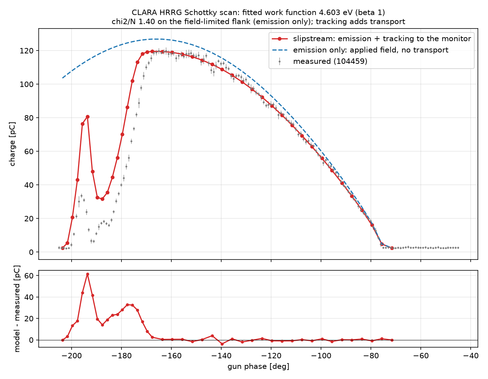
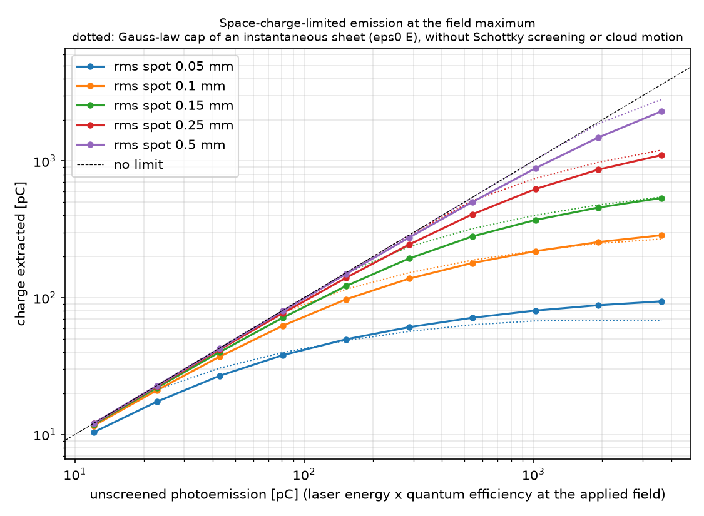

# CLARA HRRG photocathode: Schottky scan and space-charge-limited emission

`schottky_scan.py` compares slipstream's opt-in photocathode emission model
([`Photocathode`](../../docs/modules/tracking/native/photocathode.md)) with a measured Schottky scan of the CLARA high
repetition rate gun, then scans the extracted charge against laser energy for several spot sizes.

| File | Content |
| --- | --- |
| `104459_Schottky_approx_crestingData.h5` | measured scan: `xData` gun phase [deg], `yData` charge [pC], `yStd` [pC] |
| `Example_Shottky_Scan.jpg` | a plot of this scan with the phase axis shifted by +167 deg (0 at the start of the plateau) |
| `CLA-VCA-DIA-CAM-01_2022-04-29_10-14-01UTC_1_images.hdf5` | camera frame of the laser at the virtual cathode (`Capture000001`, 188.5 px/mm, x along the columns, y along the rows); the attributes hold the machine settings at the capture |
| `generator.in` | the laser profile: the transverse cut gaussian fitted to that frame, an assumed 2 ps flat-top and 0.62 eV emission |
| `fit_laser_image.py` | fits the frame and prints the `generator.in` lines |
| `schottky_scan.py` | the fit, the tracked scan and the saturation scan |
| `reference/` | `schottky_scan.py` outputs (CUDA, float32, 1500 macroparticles, made with the laser assumed before the spot was measured: 3 ps flat-top, 0.25 mm rms round gaussian) and `fit_laser_image.py` outputs |

```bash
python examples/photocathode/fit_laser_image.py                    # about 10 seconds, no GPU
python examples/photocathode/schottky_scan.py                      # about 9 minutes on a laptop GPU (RTX 3050)
python examples/photocathode/schottky_scan.py --dt-ceiling-ps 2    # about 3 minutes, charges within 1.2 pC rms
python examples/photocathode/schottky_scan.py --quick              # coarser, 600 macroparticles
python examples/photocathode/schottky_scan.py --only saturation --no-plots
```

The tracking is `torch.compile`d on CUDA (`--no-compile` for the eager path, about 10 times slower per step; `--warp` adds the
Warp kernels, which cost more than they save on this GPU). `--dt-ceiling-ps 2` lets the step grow with the space-charge
frequency after emission, about 4 times fewer steps; against the fixed 0.4 ps step of `reference/` the monitor charge
changes by 1.2 pC rms (at most 6.7 pC in the sparse tail of the cut-off, +1 pC in the ramp).

It needs the optional `laura` and `laura_lattices` packages (CLARA gun, solenoid and apertures) and, for plots,
`slipstream-accel[plot]`. Without CUDA use `--device cpu` (much slower). `--generator`, `--wavelength-nm`, `--qe`, `--beta`,
`--gun-field-MV`, `--solenoid-T` and `--monitor-z` replace the assumed laser, photocathode, gun, solenoid and monitor plane.

## Laser spot

`fit_laser_image.py` fits the virtual-cathode frame (captured 2022-04-29 10:14 UTC, the day of the Schottky scan) with the
distribution `generator.in` can draw, `Dist_x = Dist_y = 'g'`: two independent gaussians cut at `C_sig` sigma,
convolved with an edge blur that the generator's sharp cut leaves out. The frame is a clipped gaussian: an uncut gaussian
leaves a 26 % larger residual (40.0 against 31.6 counts rms on a 976 count peak).

| | x | y |
| --- | --- | --- |
| `sig` [mm] | 0.565 +- 0.043 | 0.344 +- 0.018 |
| `C_sig`, the n-sigma cut | 1.55 +- 0.15 | 2.3 +- 0.3 |
| cut at [mm] | +-0.875 | +-0.797 |
| rms size of the cut distribution [mm] | 0.429 | 0.321 |

The uncertainties are a block jackknife, which includes the hot spots in the laser profile. The edge is well defined (0.875
and 0.80 mm are where the image falls to half its edge value), but `sig` and `C_sig` trade off through those hot spots:
`C_sig_x` can be lower (1.2 with `sig_x` 0.68 mm leaves a residual only 1.6 % larger) but not higher (2.0 leaves 10 % more).
The y cut at 2.3 sigma, where a gaussian holds only 7 % of its peak, barely changes the residual (anything from 2 sigma to no
cut at all is within 1.8 %); the faint edge seen in the image sets it. The edge blur is 0.10 mm rms (imaging and
diffraction). The spot centre is at (-1.09, +0.44) mm from the sensor centre; that is not applied (`x_off`, `y_off` stay 0)
because the position of the cathode axis on the sensor is not known.

The edge of the image is round, and two independent cuts give a rounded rectangle. A gaussian clipped by an ellipse of
semi-axes 0.910 x 0.812 mm fits better (27.0 counts rms, `sig` 0.575 and 0.357 mm). ASTRA's generator cannot draw that, so
`generator.in` has the independent-cut fit; its rms sizes are 2 % larger than the second moments of the image
(0.429 x 0.321 mm against 0.420 x 0.314 mm), the excess being the corners.


Effect on the scan. Against the 0.25 mm rms round gaussian that `reference/` assumed (both 3 ps, `--dt-ceiling-ps 2`, 131072
macroparticles), space-charge-limited emission keeps 0.977 of the ideal charge at the field maximum instead of 0.944, and the
laser energy that matches the plateau falls from 5.80 to 5.61 uJ for QE 1e-4. The plateau, the field-limited flank and the zero
crossing change by 0.3 pC rms. The aperture-limited low-phase end (-168 to -204 deg) changes by 7 pC rms (16 pC at most) and
ends 3 pC rms closer to the measurement (26.6 to 23.8 pC rms); the ramp is still late. The 2 ps flat-top now in `generator.in`,
against 3 ps, changes the field-limited part by 0.3 pC rms and the low-phase end by 2.3 pC rms (7.4 pC at most); the
emission-law fit has chi2 per point 1.37 against 1.40.

## What the scan contains

The laser is fixed and the gun phase is scanned, so the charge combines three things.

- **Emission.** The cathode field is `E0 sin` of the RF phase. Copper at 266 nm sits just above its Schottky-lowered
  threshold, so the quantum efficiency rises steeply with field: charge follows the field through the plateau at the
  field maximum and falls to zero at the field's zero crossing (scan phase -76 deg).
- **Space charge.** At 120 pC the field of the emitted cloud cuts the emission at the field maximum by 2.4 % in the
  measured spot (5.6 % in the 0.25 mm rms round spot assumed before it was measured).
- **Transport.** Electrons emitted late in the RF half-cycle leave the gun with low energy and a large divergence. They
  fall back onto the cathode or are clipped by the 10 mm L01 aperture at z = 1.0577 m, which gives the measured ramp,
  shoulder, dip and satellite peak at the low-phase end (-170 to -200 deg).

The scan phase runs opposite to slipstream's gun phase offset `d` from the max-energy-gain crest: `phase = x0 - d`.

## Procedure

1. The field-limited flank (-170 to -70 deg) involves no transport, so the Dowell-Schmerge law with the Schottky-lowered
   work function is fitted there directly (work function, laser energy x QE, phase origin `x0`, monitor baseline).
2. One tracked run at the field maximum calibrates the laser energy so that the space-charge-limited emission matches the
   fitted plateau.
3. The whole scan is tracked: emission with space charge, fall-back onto the cathode and apertures, charge counted at a
   monitor plane `--monitor-z` (default 1.1 m, past the L01 aperture).

## Results

Field-limited flank (emission law only, `beta = 1`): work function **4.60 eV**, phase origin `x0 = -131.6 deg` (the scan
phase of the gun's max-energy-gain crest), monitor baseline 2.4 pC, chi2 per point 1.4. The laser energy x quantum
efficiency is 5.8e-10 J, i.e. 5.8 uJ for QE 1e-4 at the 120 MV/m cathode field once the few-percent space-charge
reduction is included. The 4.60 eV is the effective work function at this photon energy and field; the textbook value
for polycrystalline copper is 4.6-4.65 eV (Dowell and Schmerge tabulate 4.31 eV for atomically clean copper). The fit
constrains only `hw - phi_w` together with `beta E`: a field enhancement `beta = 2` gives 4.57 eV and `beta = 4` 4.54 eV.
The sharp zero-crossing edge limits the laser pulse: chi2 per point is 1.4 for flat-top pulses up to 3 ps, 1.5 at 5 ps,
1.7 at 8 ps and 2.2 at 12 ps.

Tracked scan (`reference/schottky_scan.png`): over the plateau, the field-limited flank and the zero crossing
(-164 to -72 deg, 23 tracked phases) the model differs from the measurement by 1.5 pC rms (3.9 pC at most, mean -0.1 pC).
The aperture-limited low-phase end (-168 to -204 deg) reproduces the ramp, the shoulder, the dip and the satellite peak
qualitatively (28 pC rms). The ramp has the measured width (100 to 40 pC in 8.7 deg against 8.3 deg) but sits 4.3 deg later
in emission phase; the dip is 32 pC at -187.6 deg against 6.5 pC at -191.1 deg, and the satellite peak 81 pC at -193.6 deg
against 34 pC at -196.1 deg. That region depends on the gun solenoid current (0.30-0.38 T moves the ramp by
about 8 deg), the gun field amplitude, the alignment of the beam on the 10 mm aperture and the laser's transverse
profile, none of which are fitted here. For orientation (transmission = monitor charge / emitted charge, scan phase
`x = 14.2 - theta`, `theta` the RF phase of the cosine field): with the nominal 0.345 T solenoid a 110 MV/m gun puts the
half-transmission point of the ramp at the measured scan phase (-176.7 deg) where 120 MV/m puts it 4.4 deg later, and
100 MV/m with 0.30 T reproduces the measured ramp transmission (0.93, 0.77, 0.57, 0.38, 0.26 at `theta` = 184, 187, 190,
193, 196 deg) to 0.02; the dip and the satellite peak then still differ. Gun field and solenoid current are degenerate
in this ramp, so use the real settings (`--gun-field-MV`, `--solenoid-T`).



Saturation (`reference/saturation_scan.png`; round gaussian spots cut at 3 sigma, not the measured spot, with the pulse
shape of `generator.in`): at the field maximum a 3 ps pulse extracts the unscreened photoemission only while the laser's
areal density stays well below the Gauss density `eps0 E`. At 157 pC unscreened (1.3 times the
measured plateau) a 0.5 mm rms spot extracts 98 %, 0.25 mm 93 %, 0.15 mm 82 %, 0.1 mm 68 % and 0.05 mm 39 %; at 2 nC
unscreened they extract 79, 48, 27, 16 and 6 %. The dotted lines are the Gauss-law cap of an instantaneous sheet. The
tracked charge lies below it at moderate overdrive (the screened surface field also lowers the Schottky yield) and above it
at strong overdrive, where the cloud leaves the surface during the 3 ps pulse.



## Assumptions to replace

- Laser: the transverse profile is measured (see Laser spot); the 2 ps flat-top and the 0.62 eV emission energy
  (`generator.in`) and 266 nm are assumed. The emission flank limits the pulse length to a few ps; the spot size only
  weakly (the laser energy absorbs the few-percent space-charge reduction).
- Gun: 120 MV/m peak field and the LAURA CLARA field map, solenoid 0.345 T, apertures from LAURA. The charge monitor is
  taken to lie downstream of the 10 mm L01 aperture (the WCM at 0.676 m would not see it).
- Quantum efficiency: `qe = 1e-4` at the cathode field is a placeholder; the fit fixes `qe x energy` = 5.8e-10 J (5.6e-10 J
  with the measured spot), so a measured laser energy gives the quantum efficiency directly (`qe = 5.8e-10 J / E_laser`).
  The attributes of the camera frame record a laser energy readback `CLA-LAS-DIA-EM-06:E_RB` = 0.539 (no unit stored; in uJ
  at the cathode it would give `qe` = 1.0e-3) and the charge monitor `CLA-S01-DIA-WCM-01:Q` = 99.7 pC.
